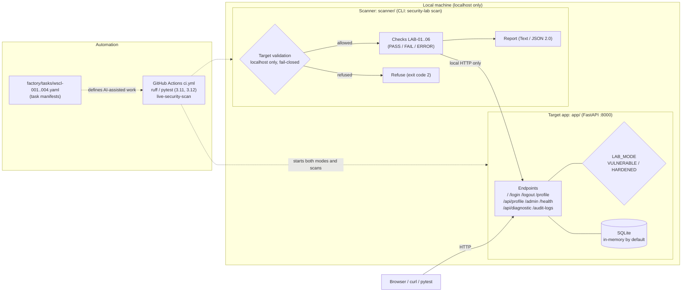

# Web Security Control Lab

[English](README.md) | [日本語](README.ja.md)

[](https://github.com/moruku36/web-security-control-lab/actions/workflows/ci.yml)


A localhost-only educational lab for observing vulnerable web behavior, detecting security issues, explaining causes, applying remediation, and verifying the hardened result.

## Learning cycle

**Observe → Detect (scanner) → Explain → Remediate → Reverify.** The FastAPI application and its SQLite test data provide an intentionally small environment for learning authentication, authorization, and web-configuration controls. The app starts in `VULNERABLE` mode by default; set `LAB_MODE=HARDENED` to enable the corresponding controls.

The scanner validates its localhost-only boundary and refuses anything else before sending a request. This repository is intended for local education and verification only; see [SECURITY.md](SECURITY.md).

## Architecture overview



- **Target application (`app/`, FastAPI)** serves the lab endpoints and runs in `VULNERABLE` mode with intentional weaknesses or `HARDENED` mode with the corresponding controls applied. Test data lives in SQLite (in-memory by default, configurable with `LAB_DB_PATH`), accessed only by the application.
- **Scanner (`scanner/`, Python CLI)** sends HTTP requests to the running application, runs six local checks (LAB-01 to LAB-06) and reports PASS, FAIL or ERROR for each. It refuses targets outside the local allowlist and never touches SQLite directly.
- **Automation (`.github/workflows/ci.yml`, `factory/`)** runs lint, tests and live scans of both modes in CI, and holds the task manifests used for AI-assisted changes.

Docker Compose starts only the target application; run the scanner from your host. See [docs/ARCHITECTURE.md](docs/ARCHITECTURE.md) (Japanese) for the detailed diagram. The six checks cover a limited local scope, so a clean scan does not establish that an application is secure.

## Quick start

Requires Python 3.11+ (or Docker).

```bash
git clone https://github.com/moruku36/web-security-control-lab.git
cd web-security-control-lab
python -m venv .venv
source .venv/bin/activate        # Windows: .\.venv\Scripts\activate
pip install -e .[dev]

# VULNERABLE mode (default)
uvicorn app.main:app --host 127.0.0.1 --port 8000

# or HARDENED mode
LAB_MODE=HARDENED uvicorn app.main:app --host 127.0.0.1 --port 8001
```

With Docker: `docker compose up --build` (VULNERABLE mode on `http://127.0.0.1:8000`).

Then scan from another terminal:

```bash
security-lab scan http://127.0.0.1:8000 --format json --expected-mode VULNERABLE
```

> **TEST CREDENTIALS - DO NOT USE IN PRODUCTION:** `alice` / `user` (role `user`) and `admin` / `admin` (role `admin`) are fixed fixtures for local exercises.

## Lab scenarios

| Lab ID | Weakness | Severity |
| :--- | :--- | :--- |
| LAB-01 | Broken access control: a non-admin user can reach `/admin` | HIGH |
| LAB-02 | Session cookie `lab_session` lacks `HttpOnly` | MEDIUM |
| LAB-03 | Session cookie lacks `SameSite` | MEDIUM |
| LAB-04 | Missing security headers (CSP, `X-Content-Type-Options`, `Referrer-Policy`, ...) | MEDIUM |
| LAB-05 | Information disclosure: `/api/diagnostic` exposes detailed error information | LOW |
| LAB-06 | Failed logins are not recorded in the audit log (`AUTH_FAILURE`) | MEDIUM |

Expected scanner result: `VULNERABLE` → HIGH 1 / MEDIUM 4 / LOW 1; `HARDENED` → 0 findings. CI verifies both.

## Contents

- [SECURITY.md](SECURITY.md)
- [app/](app), [scanner/](scanner), [tests/](tests), [factory/](factory), [docs/](docs)

## Detailed documentation

The [research and improvement roadmap](docs/SURVEY_ROADMAP.md) ([日本語](docs/SURVEY_ROADMAP.ja.md)) separates the implemented baseline from proposed changes and defines measurable learning objectives: predict, observe, explain the cause, repair, reverify, and explain the remaining limits. Zero findings for the six local checks is not evidence of production security. The proposed changes and educational effectiveness have not yet been validated.

Most other documents under `docs/` ([LAB_GUIDE](docs/LAB_GUIDE.md), [SECURITY_CONTROLS](docs/SECURITY_CONTROLS.md), [ARCHITECTURE](docs/ARCHITECTURE.md)) are written in Japanese. The [Japanese README](README.ja.md) has the full setup guide, scanner output examples and repository layout.

## LAB-01 worksheet and scanner outcomes

The [LAB-01 worksheet](docs/worksheets/LAB01.md) ([日本語](docs/worksheets/LAB01.ja.md)) walks through predict, observe, explain, repair, reverify and limits. The worked [solution](docs/solutions/LAB01.md) ([日本語](docs/solutions/LAB01.ja.md)) is a separate file; read it after your own attempt. The worksheet is formative practice, not a validated measure of learning.

The scanner JSON is schema 2.0. It keeps the legacy `target`, `findings` and `summary` fields and adds `schema_version`, `mode`, `generated_at`, `checks` and `status_summary`. Each of the six checks is PASS (condition met), FAIL (weakness observed) or ERROR (a prerequisite could not be established). ERROR is never a success, and zero findings do not mean production safety. Exit codes: `0` completed report (observed weaknesses included), `1` no subcommand, `2` target refusal or argument error, `3` incomplete inspection or runtime error. Returning `3` for an incomplete inspection is an intentional change: unexpected responses could previously exit `0`, so consumers that parse the exact JSON shape must migrate. The target URL must be a bare `scheme://host[:port]`; credentials, paths, queries and fragments are refused before any request. `--expected-mode VULNERABLE|HARDENED` makes the intended mode explicit; the reported `mode` is otherwise whatever the local target says, not independently verified. Scanner HTTP clients ignore proxy environment variables and never follow redirects.
