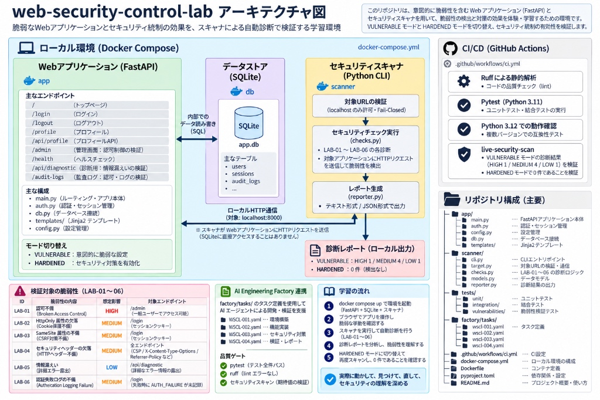

# Web Security Control Lab

[English](README.md) | [日本語](README.ja.md)

A localhost-only educational lab for observing vulnerable web behavior, detecting security issues, explaining causes, applying remediation, and verifying the hardened result.

## Learning cycle

Observe the vulnerable application, run the scanner, explain each finding, remediate the control, and rescan the hardened result. The FastAPI application and SQLite test data provide an intentionally small environment for learning authentication, authorization, and web-configuration controls.

The scanner validates its localhost-only boundary. Use `docker-compose.yml`, the application source, scanner source, and `docs/` together with the Japanese run guide. This repository is intended for local education and verification.

## Contents

- [SECURITY.md](SECURITY.md)
- [app/](app)
- [docs/](docs)
- [factory/](factory)
- [scanner/](scanner)
- [tests/](tests)

## Architecture overview

The lab has three parts that run on your own machine:

- **Target application (`app/`, FastAPI)** serves the lab endpoints and runs in a `VULNERABLE` mode with intentional weaknesses or a `HARDENED` mode with the corresponding controls applied. It keeps its test data in SQLite, which only the application accesses.
- **Scanner (`scanner/`, Python CLI)** sends HTTP requests to the running application, checks the six local controls (LAB-01 to LAB-06) and reports PASS, FAIL or ERROR for each. It refuses targets outside localhost.
- **Automation (`.github/workflows/ci.yml`, `factory/`)** runs lint, tests and local scans in CI, and holds the task manifests used for AI-assisted changes.

The diagram is an overview; [docs/ARCHITECTURE.md](docs/ARCHITECTURE.md) (Japanese) has the detailed interaction diagram. The six checks cover a limited local scope, so a clean scan does not establish that an application is secure.

## Detailed documentation

The [research and improvement roadmap](docs/SURVEY_ROADMAP.md) ([日本語](docs/SURVEY_ROADMAP.ja.md)) separates the implemented baseline from proposed changes and defines measurable learning objectives: predict, observe, explain the cause, repair, reverify, and explain the remaining limits. Zero findings for the six local checks is not evidence of production security. The proposed changes and educational effectiveness have not yet been validated.

## LAB-01 worksheet and scanner outcomes

The [LAB-01 worksheet](docs/worksheets/LAB01.md) ([日本語](docs/worksheets/LAB01.ja.md)) walks through predict, observe, explain, repair, reverify and limits. The worked [solution](docs/solutions/LAB01.md) ([日本語](docs/solutions/LAB01.ja.md)) is a separate file; read it after your own attempt. The worksheet is formative practice, not a validated measure of learning.

The scanner JSON is schema 2.0. It keeps the legacy `target`, `findings` and `summary` fields and adds `schema_version`, `mode`, `generated_at`, `checks` and `status_summary`. Each of the six checks is PASS (condition met), FAIL (weakness observed) or ERROR (a prerequisite could not be established). ERROR is never a success, and zero findings do not mean production safety. Exit codes: `0` completed report (observed weaknesses included), `1` no subcommand, `2` target refusal or argument error, `3` incomplete inspection or runtime error. Returning `3` for an incomplete inspection is an intentional change: unexpected responses could previously exit `0`, so consumers that parse the exact JSON shape must migrate. The target URL must be a bare `scheme://host[:port]`; credentials, paths, queries and fragments are refused before any request. `--expected-mode VULNERABLE|HARDENED` makes the intended mode explicit; the reported `mode` is otherwise whatever the local target says, not independently verified. Scanner HTTP clients ignore proxy environment variables and never follow redirects.

The [Japanese guide](README.ja.md) retains the complete original setup instructions, configuration, examples, project status, and limitations. Supporting documents keep their existing language.
