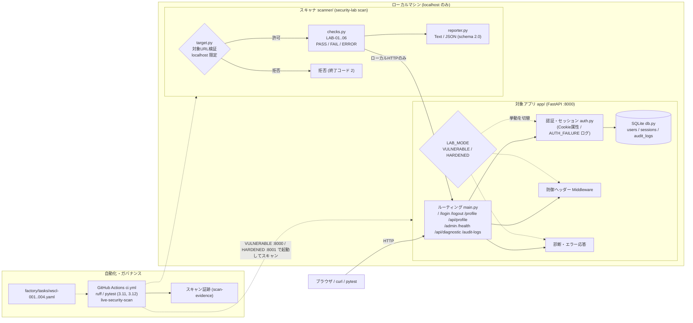

# アーキテクチャ概要 (Architecture Overview)

`web-security-control-lab` は、疎結合された3つのレイヤーで構成されています。

1. **対象Webアプリケーション (`app/`)**: 設定フラグ（`VULNERABLE` / `HARDENED`）で挙動を切り替え可能な、FastAPIベースのローカル教育用Webサービス。
2. **セキュリティ統制スキャナ (`scanner/`)**: `localhost` 以外へのリクエストを確実に遮断するFail-Closedな安全境界を備えたPython製CLIツール。
3. **自動化・ガバナンス層 (`.github/workflows/ci.yml` および `factory/`)**: CI（ruff / pytest / 両モードのライブスキャン）と、AI支援開発の宣言的なタスクマニフェスト（`factory/tasks/wscl-*.yaml`）。

アプリとスキャナはどちらもローカルマシン上で動作し、スキャナはHTTPでのみアプリに接続します（SQLiteには直接アクセスしません）。Docker Compose で起動するのは対象アプリのみで、SQLite はアプリプロセス内の既定インメモリDB（`LAB_DB_PATH` で変更可）です。

## システム構成図 (System Diagram)

期待されるスキャン結果は、`VULNERABLE` が HIGH 1 / MEDIUM 4 / LOW 1、`HARDENED` が 0 件です（CI の `live-security-scan` で検証）。

## 安全境界と Fail-Closed ガードレール (Security Boundary)
スキャナ（`scanner/target.py`）が許可するターゲットは以下に厳格に制限されています:
- `http://localhost:<port>`
- `http://127.0.0.1:<port>`
- `http://[::1]:<port>`
- `http://web-security-control-lab-app:<port>`

これ以外のパブリックIP、外部ドメイン、リモートホストが指定された場合、いかなる外部パケットも送信せずに即時異常終了（終了コード 2）します。
